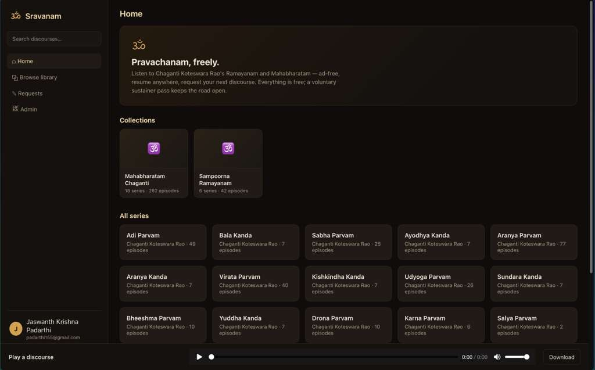

# Sravanam (శ్రవణం)

A free, ad-free way to listen to Telugu pravachanam — **FastAPI + PostgreSQL** backend with a
responsive web client, deployed with Docker Compose.

No paywall, no ads, no tracking. Discourses are linked back to their public sources, and listeners
can request any discourse they want added.



## What it does

- **Catalogue** — speakers, series and individual discourses, ingested from a read-only media
  archive by scanning it into Postgres.
- **Listen** — media is delivered from the mounted archive; playback position is stored per user so
  a discourse resumes where it stopped.
- **Requests** — a listener can ask for a discourse that isn't in the catalogue; admins triage the
  queue.
- **Accounts** — email + password with JWT sessions; admin endpoints are role-gated.
- **One deployable** — the FastAPI process serves both the JSON API and the web client.

## Stack

| Layer | Choice |
|---|---|
| API | FastAPI, SQLAlchemy 2 (typed `Mapped[...]` models), Pydantic schemas |
| Database | PostgreSQL 16, schema managed by **Alembic** migrations |
| Auth | JWT bearer tokens, **Argon2** password hashing, role-gated admin router |
| Media | Read-only bind mount (`/media`), streamed by the API |
| Client | Vanilla JS + CSS, served by the same FastAPI app |
| Runtime | Docker Compose on a Raspberry Pi 4 (ARM64) |

## Data model

```
User ──< Progress >── Item >── Series >── Speaker
User ──< Request            Item ──< Download
```

`Item` is a single discourse; `Series` groups them (e.g. *Ayodhya Kanda Parvam*); `Speaker` is the
pravachanakarta. `Progress` and `Download` are per-user, which is what makes a series resumable
across devices.

## API

| Method | Path | Purpose |
|---|---|---|
| `POST` | `/api/auth/register` · `/api/auth/login` | account creation, JWT issue |
| `GET` | `/api/auth/me` | current user |
| `GET` | `/api/catalog/series` · `/series/{id}` · `/items/{id}` | browse the catalogue |
| `GET` | `/api/media/{item_id}/stream` · `/download` | audio delivery |
| `GET` | `/api/progress` | list resume positions |
| `PUT` | `/api/progress/{item_id}` | set resume position |
| `POST` | `/api/requests` · `GET /mine` | listener requests |
| `GET` | `/api/admin/summary` | ingest + catalogue health |
| `GET`/`PATCH` | `/api/admin/requests` · `/requests/{id}` | admin triage |
| `POST` | `/api/admin/ingest` | re-scan the media archive |
| `GET` | `/health` | liveness |

## Services (docker compose)

| Service | Port | Notes |
|---|---|---|
| `db` | `127.0.0.1:5433` | Postgres 16 — bound to localhost only |
| `api` | `8110` | FastAPI — API + web client |

## Quickstart

```bash
cp .env.example .env        # set DB_PASSWORD and JWT_SECRET
docker compose up -d --build
docker compose exec api alembic upgrade head
docker compose exec api python -m app.ingest   # scan /media into the catalogue
curl -s localhost:8110/health
```

Then open <http://localhost:8110/>.

## Status

Backend and web client are running in production on the home lab. Planned, **not yet implemented**:
a Flutter client for iOS/Android, a Razorpay *sustainer* subscription (the schema has the columns;
no router exists yet — the app is fully usable without paying), and CDN delivery for media.

`DESIGN.md` holds the product and architecture decisions.
